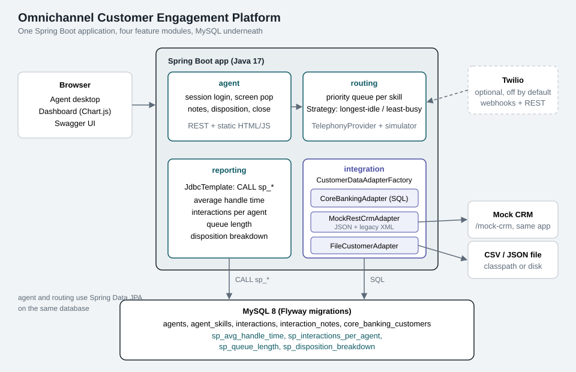
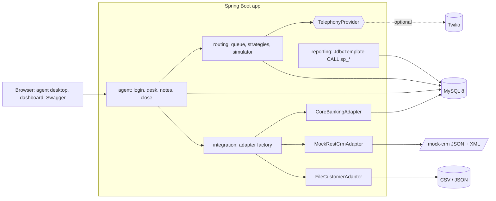

# Omnichannel Customer Engagement Platform


A small contact center platform: an agent desktop, a pluggable CRM integration layer, skill-based routing and a reporting dashboard. Java 17, Spring Boot 3, MySQL 8.

Calls and chats come from a built-in simulator (no telephony account needed). An optional Twilio provider is included and switched off by default.

> The coverage badge is a placeholder. Replace it with your own (Codecov, or a shields.io endpoint badge) after the first CI run. The JaCoCo report is generated at `target/site/jacoco/index.html` by `mvn verify` and uploaded as a CI artifact.

## The four modules

| Module | What it does |
|---|---|
| **Agent Desktop** | Login, incoming call/chat appears with a customer screen pop, notes, disposition, close. Plain HTML/CSS/JS served by Spring Boot. |
| **CRM Integration** | `CustomerDataAdapter` interface with three implementations (core banking DB, mock REST CRM with JSON and XML, CSV/JSON file). A factory picks one from `application.yml`. |
| **Routing Engine** | Skill-based (Loan, Card, Complaint, General) priority queue. Strategy pattern: `longest-idle` or `least-busy`. Simulator for demo traffic. `TelephonyProvider` interface with a simulator (default) and Twilio. |
| **Reporting Dashboard** | Average handle time, interactions per agent, queue length, disposition breakdown. Every number comes from a MySQL stored procedure. Chart.js (bundled locally). |

## Architecture





Package layout (package by feature): `agent`, `integration` (with `corebanking`, `rest`, `file`), `routing` (with `telephony`), `reporting`, `common`. Schema and procedures: [docs/DB_SCHEMA.md](docs/DB_SCHEMA.md).

## How to run

### With Docker (one command)

```bash
docker compose up --build
```

Open http://localhost:8080. Compose starts MySQL 8 and the app. Flyway creates the schema, the stored procedures and the seed data on first start. Optional: copy `.env.example` to `.env` to change the database password or the options below.

### Without Docker

You need Java 17, Maven and a MySQL 8 database named `omnichannel` with a user `omni` (password `omni_dev_pw`, or set `DB_URL`, `DB_USER`, `DB_PASSWORD`).

```bash
mvn spring-boot:run
```

### Build and test

```bash
mvn clean verify
```

Unit tests need nothing else. The integration tests start a real MySQL 8 with Testcontainers, so Docker has to be running. Without Docker they are skipped (not failed). Coverage report: `target/site/jacoco/index.html`.

## Default logins

| Username | Skills | Password |
|---|---|---|
| `priya` | Loan, General | `agent123` |
| `rahul` | Card, General | `agent123` |
| `ananya` | Complaint, Card, General | `agent123` |
| `vikram` | all four | `agent123` |
| `meera` | General, Complaint | `agent123` |

These are demo credentials seeded by a Flyway migration. Change them before putting this anywhere real.

## Try it in 60 seconds

1. Log in as `priya` at http://localhost:8080 (she is marked Available).
2. Open "Demo tools", click Generate. Loan and General interactions go to her, the rest wait in the queue.
3. The screen pop shows the customer from the active CRM adapter. Add a note, pick a disposition, close.
4. Open the Dashboard to see the numbers change.

Or feed the queue from a terminal: `scripts/simulate.sh 10`.

## API docs

- Swagger UI: http://localhost:8080/swagger-ui.html (log in first through `POST /api/auth/login`, the browser keeps the session cookie)
- OpenAPI JSON: http://localhost:8080/v3/api-docs
- Ready-made requests: [docs/api.http](docs/api.http)

Auth is a cookie session (HttpOnly, SameSite=Lax). Every `/api/**` endpoint except login needs it. All agents have the same permissions, there are no roles.

## Swap the CRM adapter (no code change)

Set `crm.adapter` in `application.yml`, or the environment variable `CRM_ADAPTER`:

| Value | Reads customers from | Extra settings |
|---|---|---|
| `core-banking` (default) | the `core_banking_customers` table through JDBC | none |
| `rest-crm` | a REST CRM over HTTP | `CRM_REST_BASE_URL`, `CRM_REST_FORMAT=json` or `xml` |
| `file` | a CSV or JSON file | `CRM_FILE_PATH`, e.g. `file:/data/customers.csv` |

```bash
CRM_ADAPTER=rest-crm CRM_REST_FORMAT=xml docker compose up
```

With `xml`, the adapter calls the legacy XML endpoint of the bundled mock CRM (`/mock-crm/legacy/...`), parses it with a hardened DOM parser (DOCTYPE disabled, so no XXE) and maps the CRM's nested shape to the flat `CustomerProfile`. The agent desktop shows which adapter supplied the data ("Data from the rest-crm adapter"). `GET /api/integration/adapter` lists the active and available adapters. A wrong value fails the startup with a message listing the valid ones.

To add a new system, implement `CustomerDataAdapter`, annotate it `@Component` and return a unique `type()`. Nothing else changes.

If the CRM is down, the screen pop shows a warning and the agent can still work the interaction.

## Routing strategy

`ROUTING_STRATEGY=longest-idle` (default) gives the interaction to the matching agent who has been available the longest. `least-busy` picks the agent with the fewest interactions today (idle time breaks ties). Add a strategy by implementing `RoutingStrategy` with `@Component("your-name")`.

Behaviour worth knowing:
- Queue order is priority (1 = high), then arrival time.
- An agent counts as ready only if Available and their desktop polled in the last 20 seconds. Closing the tab removes them from routing without any cleanup job.
- The queue is also swept every 3 seconds, so a returning agent picks up waiting work.

## Enable Twilio (optional, off by default)

Nothing here is needed to run the project. The Twilio provider is only active when `TELEPHONY_PROVIDER=twilio`.

1. Create a Twilio account and a voice-capable number.
2. Expose the app publicly (for example `ngrok http 8080`).
3. Set the environment variables, then start the app:
   ```bash
   TELEPHONY_PROVIDER=twilio
   TWILIO_ACCOUNT_SID=ACxxxxxxxx
   TWILIO_AUTH_TOKEN=xxxxxxxx
   TWILIO_PUBLIC_BASE_URL=https://your-tunnel.ngrok.app
   ```
   The app refuses to start if any of the three is missing.
4. In the Twilio console set the number's "A call comes in" webhook to `POST {TWILIO_PUBLIC_BASE_URL}/api/telephony/twilio/voice`.
5. Give the agent you log in with a phone number: `UPDATE agents SET phone = '+91XXXXXXXXXX' WHERE username = 'priya';`

Flow: the caller hears a menu (1 loans, 2 cards, 3 complaints, 4 other), the call is queued with the matching skill (the caller is matched to a customer by phone number through the active CRM adapter), and when an agent is assigned the live call is redirected to the agent's phone. Closing the interaction hangs up the call. Webhooks are verified with Twilio's `X-Twilio-Signature`.

This path has not been run against real Twilio. See "What is verified" below.

## Oracle PL/SQL equivalent of the reporting procedures

The MySQL procedures return a result set. In Oracle the same thing is a package procedure with a `SYS_REFCURSOR` out parameter:

```sql
CREATE OR REPLACE PACKAGE reporting_pkg AS
  PROCEDURE avg_handle_time(p_from IN TIMESTAMP, p_to IN TIMESTAMP, p_result OUT SYS_REFCURSOR);
  PROCEDURE queue_length(p_result OUT SYS_REFCURSOR);
END reporting_pkg;
/
CREATE OR REPLACE PACKAGE BODY reporting_pkg AS
  PROCEDURE avg_handle_time(p_from IN TIMESTAMP, p_to IN TIMESTAMP, p_result OUT SYS_REFCURSOR) IS
  BEGIN
    OPEN p_result FOR
      SELECT skill,
             COUNT(*) AS interactions,
             ROUND(AVG(EXTRACT(DAY FROM (closed_at - assigned_at)) * 86400
                     + EXTRACT(HOUR FROM (closed_at - assigned_at)) * 3600
                     + EXTRACT(MINUTE FROM (closed_at - assigned_at)) * 60
                     + EXTRACT(SECOND FROM (closed_at - assigned_at))), 1) AS avg_seconds
        FROM interactions
       WHERE status = 'CLOSED' AND closed_at BETWEEN p_from AND p_to
       GROUP BY skill
       ORDER BY skill;
  END avg_handle_time;

  PROCEDURE queue_length(p_result OUT SYS_REFCURSOR) IS
  BEGIN
    OPEN p_result FOR
      SELECT s.skill, COUNT(i.id) AS waiting
        FROM (SELECT 'LOAN' skill FROM dual UNION ALL SELECT 'CARD' FROM dual
              UNION ALL SELECT 'COMPLAINT' FROM dual UNION ALL SELECT 'GENERAL' FROM dual) s
        LEFT JOIN interactions i ON i.skill = s.skill AND i.status = 'QUEUED'
       GROUP BY s.skill;
  END queue_length;
END reporting_pkg;
/
```

Differences to mention: `TIMESTAMPDIFF` becomes interval arithmetic with `EXTRACT`, a `SELECT` without `FROM` needs `FROM dual`, and the Java side switches from `CALL sp(?)` to a `CallableStatement` (or `SimpleJdbcCall`) with a cursor out parameter.

## Talking points for interviews

- **Adapter + Factory**: the platform never knows which CRM it talks to. The factory resolves the adapter by config and fails fast on a typo. Adding a system is one new class. The adapters differ on purpose: SQL, HTTP with JSON or XML, and files.
- **Strategy**: routing rules are interchangeable beans selected by property. `LongestIdleStrategy` and `LeastBusyStrategy` are pure functions of the candidate list, which is why they are trivial to unit test.
- **Why the telephony boundary is an interface**: `TelephonyProvider` keeps the routing engine free of vendor code. The simulator is the default, Twilio is a drop-in. External calls happen after the database transaction commits, and a telephony failure does not undo the assignment.
- **Concurrency in the dispatcher**: assignment runs under a lock inside a transaction. That is correct for one node. For several nodes the next step is `SELECT ... FOR UPDATE SKIP LOCKED` on the queue rows.
- **Heartbeat instead of cleanup jobs**: ready agents are those seen in the last 20 seconds, so abandoned sessions drop out by themselves.
- **Stored procedures**: reporting logic lives in SQL where the data is, called through `JdbcTemplate`. JPA is used for the transactional parts. Know why: aggregation queries read better in SQL than in JPQL. Also know the MySQL gotcha: creating a stored *function* needs SUPER when binary logging is on, so only procedures are used.
- **XML handling**: DOM + XPath parsing with DOCTYPE disabled to prevent XXE, and a transformation from the CRM's nested schema to the internal flat model.
- **Error handling**: one `@RestControllerAdvice` returns RFC 7807 `ProblemDetail` responses. Validation errors list the failing fields. A CRM outage degrades the screen pop instead of failing the desk.
- **Testing**: unit tests with Mockito for routing, desk rules and adapters; `MockRestServiceServer` for the REST adapter; Testcontainers MySQL for end-to-end flow and for the stored procedures. Real MySQL on purpose, H2 would not run these procedures.
- **Known limits (be honest about them)**: polling instead of WebSockets, single-node dispatch lock, no roles, a stuck BUSY agent needs a manual fix, no rate limiting on login.

## Project docs

- [docs/DEMO_SCRIPT.md](docs/DEMO_SCRIPT.md): 3-minute demo recording script
- [docs/RESUME_BULLETS.md](docs/RESUME_BULLETS.md): resume bullets for three audiences
- [docs/BLOG_OUTLINE.md](docs/BLOG_OUTLINE.md): "Building a CRM adapter layer in Java"
- [docs/DB_SCHEMA.md](docs/DB_SCHEMA.md): ER diagram and procedure list
- [docs/api.http](docs/api.http): sample requests

## What is verified

This project was generated in a sandbox that could not download Maven dependencies and had no Docker. Be clear about this when you present it:

- **Run and passed in the sandbox**: the three Flyway migrations on a real MySQL 8 server (binary logging on) and all four stored procedures; the Core Banking phone-lookup SQL; 35 unit tests covering routing strategies, the routing engine, desk and agent services, the adapter factory, JSON/XML/CSV parsing, XXE rejection and the Twilio signature check (compiled and run with JUnit 5 and Mockito against small stand-ins for the Spring types, not against Spring itself); JavaScript syntax checks.
- **Not run anywhere yet**: `mvn clean verify` with the real Spring Boot dependencies, `docker compose up`, the Testcontainers integration tests, Spring wiring (controllers, JPA mappings, bean creation) and the Twilio flow. The first `mvn clean verify` may need small fixes. Run it before you show this to anyone.

Suggested first checks: `mvn clean verify`, then `docker compose up --build`, then the 60-second walkthrough above.
