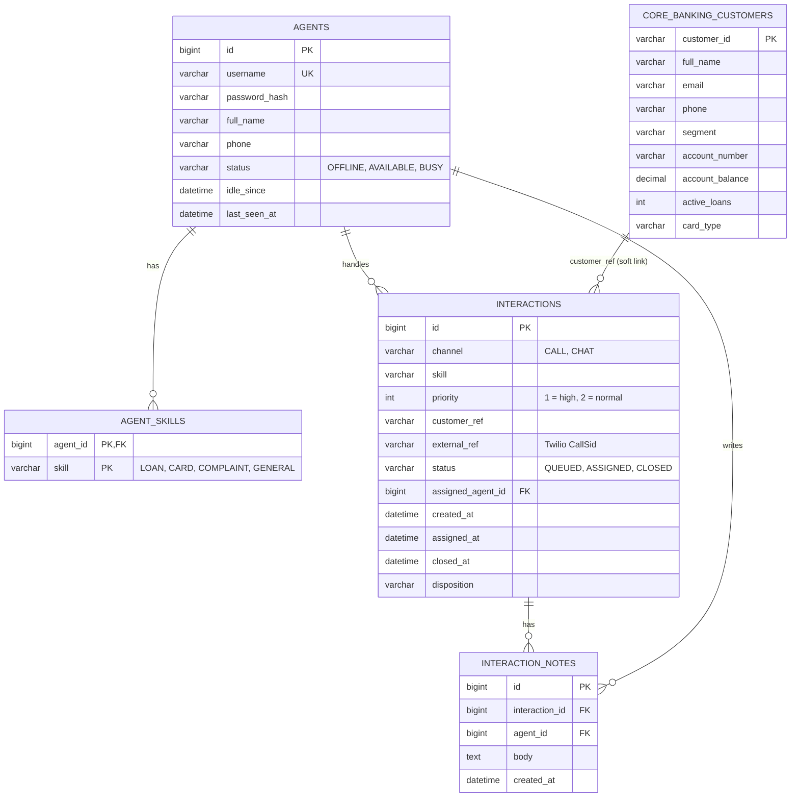

# Database schema

Created by Flyway: `V1__schema.sql` (tables), `V2__reporting_routines.sql` (stored procedures), `V3__seed_data.sql` (agents, customers, 80 closed interactions from the last two weeks).

## Design notes

- `interactions.customer_ref` is deliberately not a foreign key. The customer lives in whatever system the CRM adapter points at (core banking table, REST CRM, file), so the platform only keeps the reference.
- The queue is the `interactions` table itself: `status = 'QUEUED'` ordered by `priority, created_at`. Index `idx_interactions_queue` covers that query.
- `agents.last_seen_at` is a heartbeat updated by the desktop poll. Routing only considers agents seen in the last 20 seconds, so a closed browser tab does not leave a ghost agent receiving calls.
- `idle_since` is set when an agent becomes available and drives the longest-idle strategy.
- Status columns are `VARCHAR` mapped to Java enums with `@Enumerated(STRING)`. Hibernate schema validation is off because Flyway owns the schema.

## Stored procedures

| Procedure | Arguments | Returns |
|---|---|---|
| `sp_avg_handle_time` | `p_from`, `p_to` | skill, interactions, avg_seconds (assigned to closed) |
| `sp_interactions_per_agent` | `p_from`, `p_to` | agent, interactions (agents with zero included) |
| `sp_queue_length` | none | skill, waiting (all four skills, zeros included) |
| `sp_disposition_breakdown` | `p_from`, `p_to` | disposition, total |

There is no stored function on purpose. On MySQL 8 with binary logging enabled (the default), a non-root user cannot create one without `log_bin_trust_function_creators`, which would make `docker compose up` fragile.
